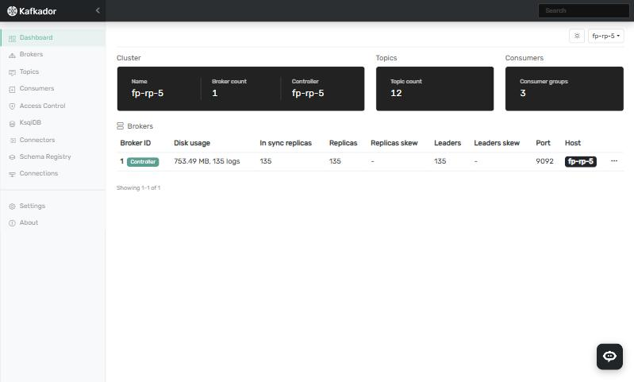
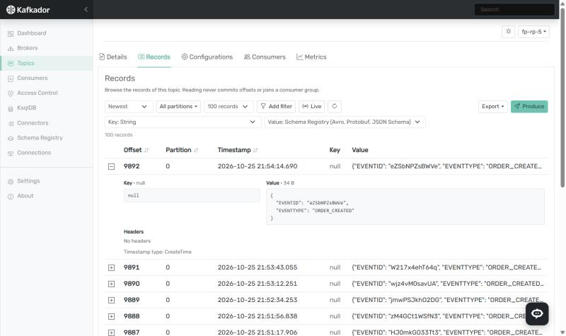
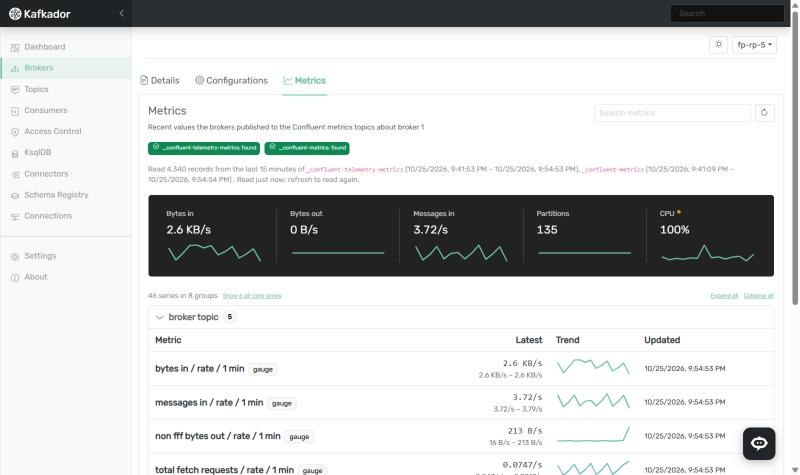
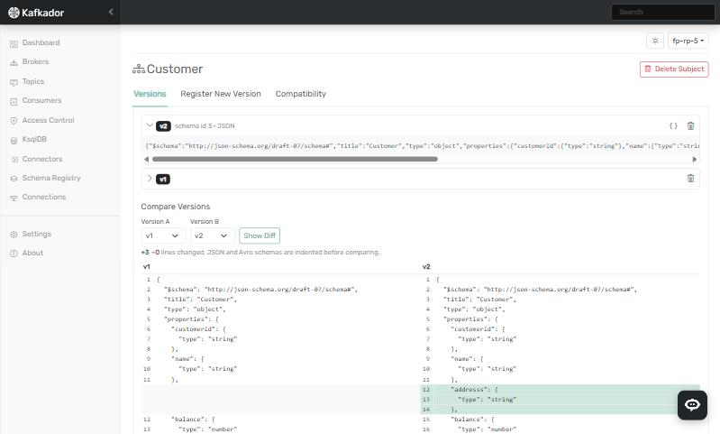

# Kafkador

**Kafkador** is a web console for **Apache Kafka** and **Confluent Platform**: see what your clusters are doing and
manage them from the browser, from brokers and topics down to single records, consumer offsets, ACLs, Schema Registry,
Kafka Connect and ksqlDB.

It's a Spring Boot backend with an Angular UI, shipped as one jar or one Docker image.

> **Version 1.0.0-beta.1.** Kafkador has no user login yet: anyone who can reach it can use every feature. Run it
> only where people you trust can reach it (see [DOCKER.md](DOCKER.md)).



---

## Features

**Clusters and brokers**
- Cluster overview: brokers, controller, partition health (online, under-replicated, out-of-sync replicas)
- Broker details and configuration, editable where Kafka allows
- Broker and topic metrics from the Confluent metrics topics: headline numbers with trends, and every series grouped
  and searchable

**Topics and records**
- Create, configure and delete topics; partitions, replicas and per-topic consumers
- Browse records from the newest, the oldest, an offset or a point in time, with filters, live tailing and export
- Decode keys and values as text, JSON, numbers, bytes, or with **Schema Registry** (Avro, Protobuf and JSON
  Schema), picked automatically when the topic has a subject
- Produce records, with headers

**Consumers**
- Consumer groups, their members, partition assignments and lag
- **Reset offsets** to the earliest or latest offset, a date and time, or a given offset, previewed first

**Security and ecosystem**
- ACLs: list, create, edit and delete bindings
- Schema Registry: subjects, versions, a side-by-side diff of two versions, compatibility settings
- Kafka Connect: connectors and plugins; create, configure, pause, resume, restart
- ksqlDB: streams, tables and persistent queries; run statements
- Clusters with TLS and SASL (PLAIN, SCRAM), and Schema Registry, Connect and ksqlDB behind Basic or bearer
  authentication with a custom CA
- An optional AI assistant that answers questions about the connected cluster

| Records, decoded from Avro | Broker metrics | Schema version diff |
|---|---|---|
|  |  |  |

Works with Apache Kafka 2.1 or newer and Confluent Platform (it uses the Kafka 4.0 client). See
[CHANGELOG.md](CHANGELOG.md) for what changed in each release.

---

## Getting started

### Docker (quickest)

```bash
curl -O https://raw.githubusercontent.com/farzinpashaee/kafkador/main/docker-compose.yml
docker compose up -d
```

Then open http://localhost:8080. [DOCKER.md](DOCKER.md) covers connecting to Kafka, configuration, backups and how
releases are published.

### From source

You need **JDK 21** and, for the UI, **Node 22.12+** with npm. Maven comes with the project (`mvnw`).

```bash
git clone https://github.com/farzinpashaee/kafkador.git
cd kafkador/backend
./mvnw clean package -P with-frontend
java -jar target/kafkador.jar        # UI and API on http://localhost:8080
```

### First-run setup

The first time Kafkador starts, it asks for a username and password for its embedded database. So that whoever reaches
a new instance first can't claim it, the setup page also asks for a **one-time setup token**, printed in the log at
startup:

```
============================================================
Kafkador needs first-run setup. The setup page asks for this
one-time setup token:  3f9c1e...
============================================================
```

Or skip the setup page by giving the credentials up front, e.g. in Docker or Kubernetes:

```bash
KAFKADOR_SETUP_USERNAME=kafkador_admin KAFKADOR_SETUP_PASSWORD='a-long-password' java -jar kafkador.jar
```

`KAFKADOR_SETUP_TOKEN` chooses the token instead of a random one. The `dev` profile doesn't ask for a token.

Connections, settings and saved credentials are kept in that embedded database, under `./data` next to where Kafkador
runs.

---

## Development

The repository has three modules:

| Folder | What it is |
|---|---|
| `backend/` | Spring Boot 3.5 (Java 21): the API, and the UI when bundled |
| `frontend/` | Angular 20: the web UI |
| `agent/` | Optional Java agent for Kafka brokers that reports metrics to Kafkador |

Run the backend with the `dev` profile, then the Angular dev server:

```bash
cd backend && ./mvnw spring-boot:run -Dspring-boot.run.profiles=dev
cd frontend && npm start          # http://localhost:4200
```

In IntelliJ, put `dev` under **Active profiles** in the run configuration (or set `SPRING_PROFILES_ACTIVE=dev`).
The profile lets the dev server (ports 4200 and 4210) call the API from its own origin and turns on the H2 console at
`/kafkador-h2`. Neither is on without it: deployments serve the UI from the API's origin, and the console gives full
access to Kafkador's database. To let another origin call the API, list it under `kafkador.cors.allowed-origins`.

Sessions start with a 30-minute idle timeout; **Settings → Generic** can raise it to at most 24 hours.

Tests: `./mvnw test` in `backend/`, `npm test` in `frontend/`.

The version is set once, in `backend/pom.xml`; the UI shows what the running backend reports. `frontend/package.json`
carries the same number, which a backend test checks.

---

## Building

Both build modes need JDK 21.

### One jar that serves the API and the UI

```bash
cd backend
./mvnw clean package -P with-frontend
java -jar target/kafkador.jar        # UI and API on http://localhost:8080
```

The `with-frontend` profile downloads a local Node/npm (nothing to install), runs `npm ci` and `npm run build`
in `frontend/`, and copies the result into the jar's `static/` folder. Add `-DskipTests` to skip backend tests.
When the UI is bundled the jar serves the Angular app for every non-API URL (deep links and refreshes work); without
the profile the jar serves only the API.

### The backend and frontend separately

```bash
# backend: API-only jar plus a start/stop script
cd backend
./mvnw clean package
#   -> target/kafkador.jar, target/starter.sh

# frontend: static files (Node 22.12+ / npm)
cd ../frontend
npm ci
npm run build
#   -> dist/kafkador/browser
```

`npm run build` produces a production build that calls the API on the **same origin** (`/api/v1`), so serve
`dist/kafkador/browser` from a web server that forwards `/api` to the backend.

### Starting the built jar

`target/starter.sh` (generated during `package`) stops any running Kafkador instance, then starts the jar in the
background, writing `starter.pid` and `starter.log` next to it:

```bash
./starter.sh                                  # start / restart
./starter.sh --config /path/to/override.yml   # layer overrides on top of the packaged application.yml
./starter.sh --server.port=9090               # any other argument is passed straight to java
```

The H2 database is created at `./data/kafkadordb` relative to where the jar is started, so run it from a stable
directory (not `target/`, which `mvn clean` deletes) if you want to keep your data.

---

## License

Kafkador is **source-available** under the [PolyForm Shield License 1.0.0](LICENSE): you may use, change and share it
for free, including at work, but not to offer a product or service that competes with Kafkador, such as selling it or
running it as a paid service. Because of that limit it isn't "open source" in the
[OSI](https://opensource.org/osd) sense.

Copyright 2025-2026 [Codestreamlab](https://codestreamlab.com).
